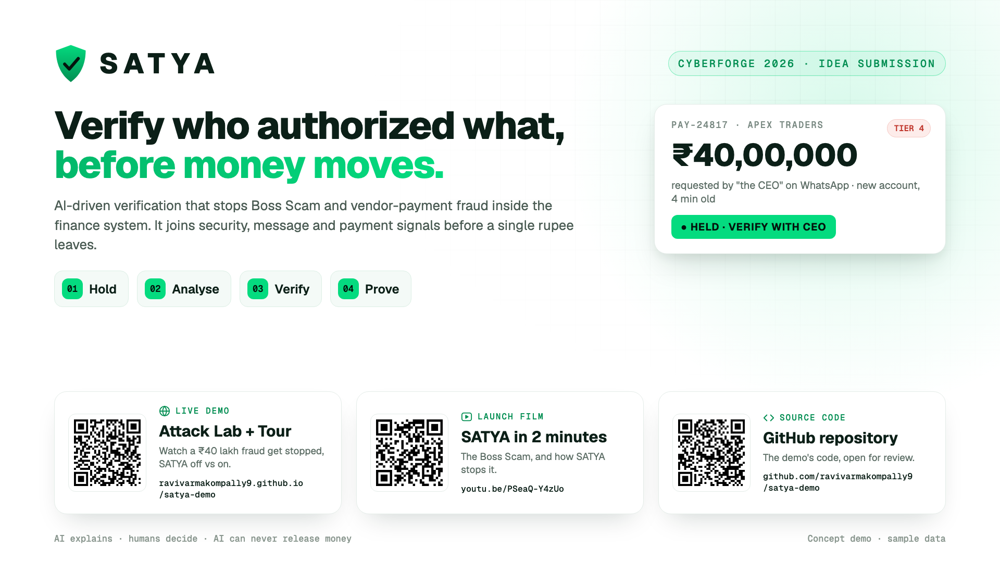

# SATYA

**Verify who authorized what, before money moves.**

SATYA is an AI-driven verification layer that stops impersonation fraud, such as the "Boss Scam" and fake
vendor bank-detail changes, inside a company's finance system, before money leaves.



## Links

| | |
|---|---|
| **Live demo** (Live Attack Lab and product tour) | https://ravivarmakompally9.github.io/satya-demo/ |
| **Launch film** (2 min) | https://youtu.be/PSeaQ-Y4zUo |
| **Product Requirements Document** (PDF, 24 pages) | [docs/SATYA_PRD.pdf](docs/SATYA_PRD.pdf) |
| **Links slide** (PDF / PNG) | [docs/SATYA_Links_Slide.pdf](docs/SATYA_Links_Slide.pdf) · [PNG](docs/SATYA_Links_Slide.png) |

## The problem

In 2026, India's Cyber Crime Coordination Centre (I4C) warned companies about the **Boss Scam**. Attackers
hijack an executive's WhatsApp, and "the CEO" then orders urgent transfers to mule accounts. Fake vendor
bank-change emails have cost Indian firms ₹2–3.7 crore per case.

Every existing control sees only one piece of the attack:
- Security sees the hacked laptop.
- Email filters see the message.
- Finance sees the payment.

Nobody joins them before the money leaves.

## How SATYA works

| Step | What happens |
|---|---|
| **1. Hold** | A risky payment freezes automatically inside the finance system: a new beneficiary, changed bank details, or an urgent executive order. |
| **2. Analyse** | The SATYA Analyst reads the request, even in Hinglish. It fuses device alerts, message red flags and payment anomalies into an evidence-backed risk tier (1–4). |
| **3. Verify** | A callback goes to the number already on file, never the one in the message, using challenge questions only the real person can answer. Approval is bound to the exact amount, payee and account; change one digit and it is cancelled. |
| **4. Prove** | Every signal and decision is sealed into an evidence pack for security, auditors and insurers. Confirmed fraud accounts are shared across protected companies as one-way hashes. |

**Safe by design:**
- The AI can explain and raise the tier, but it can never release money.
- The customer's policy floor only goes up.
- If anything fails, the money stays held.
- Honest payments to known vendors clear in seconds.

## The demo

- **Live Attack Lab:** replays three real attack patterns. First comes the Boss Scam (₹40 lakh). Second is a vendor bank change with a hidden AI-injection line (₹8 lakh). Third is five split payments just under the limit (₹49 lakh). Each one plays with SATYA off (the money reaches the mule account) and then with SATYA on (it stops at the gate).
- **Product tour:** covers these screens:
  - finance queue and case view
  - SATYA Analyst findings with evidence
  - prompt-injection case
  - callback script
  - approver portal with approval bound to the payment
  - evidence pack
  - security view, policy settings and insights
- **Check a message:** paste a payment request to see its warning signs and the verification it needs. This hosted version uses the built-in rules engine.

## Repository

```
index.html                 the complete demo (single self-contained page, served by GitHub Pages)
docs/SATYA_PRD.pdf         Product Requirements Document v2.1
docs/SATYA_Links_Slide.*   one-page summary with links and QR codes
```

To run it locally, open `index.html` in any modern browser. There is no build step.

> **Concept demo:** the demo uses sample data and is not a live product. All names, companies, accounts and
> numbers are fictional.

Built for **CyberForge 2026**.
